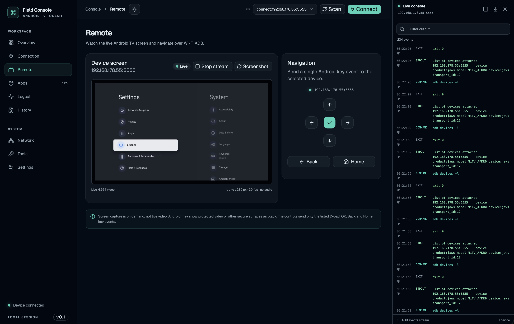
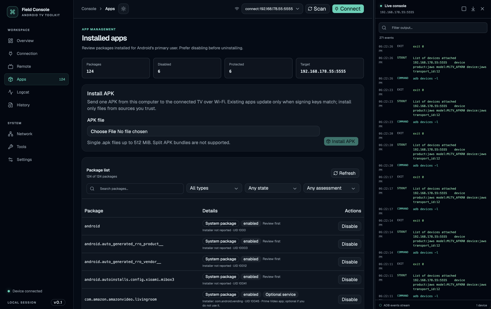

# Field Console

Manage an Android TV device over Wi-Fi from your computer. Field Console brings ADB connections, app management, device logs, and remote viewing into one local web interface. No permanent companion app is required on the TV.

> **Local-first:** The app binds to `127.0.0.1`, not your LAN. The one-time URL printed at startup contains a local access token; keep it private.

## Screenshots




## Features

- **Connect:** Wi-Fi ADB connect/disconnect, Android 11+ wireless pairing, mDNS discovery, and local-network discovery for legacy ADB on port `5555`.
- **Inspect and troubleshoot:** Right-side command/output console, live `logcat`, and a searchable package inventory with filters.
- **Manage apps:** Disable or re-enable packages, uninstall for the current user where Android allows it, and upload/install one APK at a time (up to 512 MiB). Core and active launcher packages are protected; package actions have local history with restore/undo.
- **View and control:** Still screenshots, live H.264 video, and allowlisted D-pad, OK, Back, and Home controls over Wi-Fi ADB.
- **Personalize:** Persistent light and dark themes with coordinated slate-and-teal colors.

The live view uses the scrcpy 3.3.3 server, up to 1280 px and 30 fps, without audio. It starts only when requested and is stopped when the Remote view closes. DRM-protected video and other secure surfaces may appear black. Live decoding requires a modern browser with WebCodecs; screenshots remain available as a fallback.

## Requirements

- Node.js 22 or newer and npm
- Android SDK Platform-Tools (`adb`) on your `PATH`
- An Android device with Developer options enabled; for wireless use, enable **Wireless debugging** or configure legacy ADB over TCP
- Internet access during `npm install` to download and verify the scrcpy server binary

Field Console is designed for ADB-capable Android devices, including Android TV boxes. LG webOS support is not implemented.

## Quick start

Install Platform-Tools first. On macOS with Homebrew:

```sh
brew install android-platform-tools
```

On Windows or Linux, install Android SDK Platform-Tools using the official Android tools or your package manager. Then, from the repository root:

```sh
adb version
npm install
npm run dev
```

Open the one-time local URL printed in the terminal. To run the production build instead:

```sh
npm run build
npm start
```

If `adb` is not on `PATH`, set `ADB_PATH` to its full executable path before starting the app. For example:

```sh
# macOS or Linux
export ADB_PATH="$HOME/Android/platform-tools/adb"
npm run dev
```

```powershell
# Windows PowerShell
$env:ADB_PATH = 'C:\Android\platform-tools\adb.exe'
npm run dev
```

## Connect without USB

### Android 11 and newer

1. On the TV, open **Developer options → Wireless debugging**.
2. Choose **Pair device with pairing code**.
3. In Field Console's **Connection** section, enter the TV's IP address, pairing port, and pairing code.
4. After pairing, connect using the separate IP address and connection port shown on the Wireless debugging screen.

The pairing code is redacted from the console. Pairing and connecting use different ports.

### Legacy ADB over TCP

Enter the TV's IP address and port `5555` in the connection bar. Some firmware requires enabling this mode once over USB with `adb tcpip 5555`, and may turn it off after a reboot.

On the **Connection** page, **Scan network** finds Android wireless-debugging endpoints advertised over ADB mDNS and probes up to 512 private IPv4 hosts for legacy ADB on port `5555`. The probe only tests whether that TCP port accepts a connection. Larger subnets and IPv6 are not scanned; manual entry is available.

## Platform notes

### Windows

Install Node.js 22+ and Android SDK Platform-Tools, then add the folder containing `adb.exe` to your user `PATH`. Open a new PowerShell window and run the quick-start commands above.

Alternatively, run `scripts\start-windows.bat`. It checks for Node.js, warns if ADB is missing, installs dependencies on first run, and starts the app. PowerShell users can also run `.\scripts\start-windows.ps1`. Allow ADB through Windows Firewall on private networks if discovery or connections are blocked.

### Linux

Install Node.js 22+ and Android SDK Platform-Tools, and make sure `adb` is on `PATH`. Automatic subnet discovery uses `ip route`; install `iproute2` if that command is unavailable. Firewalls, VPNs, or blocked mDNS traffic can limit discovery, but manual IP and port entry remains available.

## Safety and limitations

ADB package actions can affect device stability. Review package names before changing system apps; disabling or uninstalling a package may affect TV features, and Android generally does not allow system apps to be fully removed without elevated access. Local package history can restore supported actions, but it is not a substitute for a device backup.

Network diagnostics, deeper crash/performance tools, saved fix scripts, file management, a curated package-safety database, and LG webOS support are not implemented yet.
